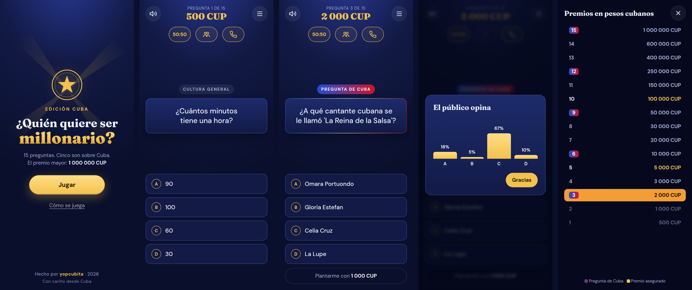
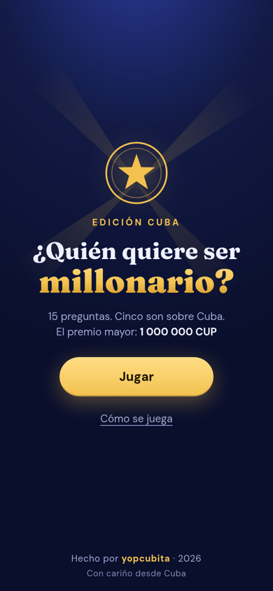
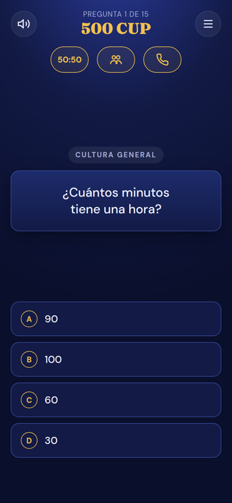
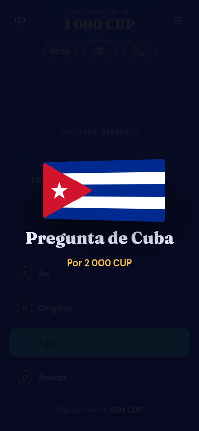
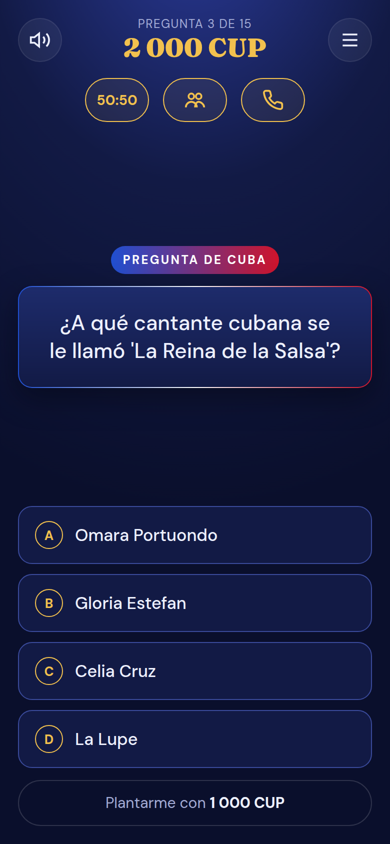
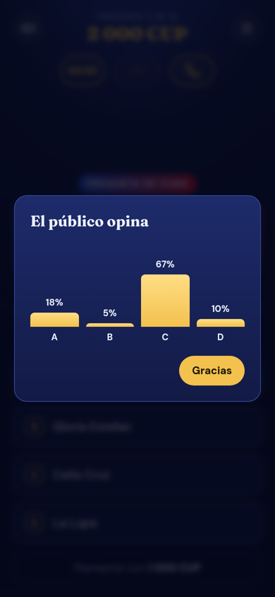
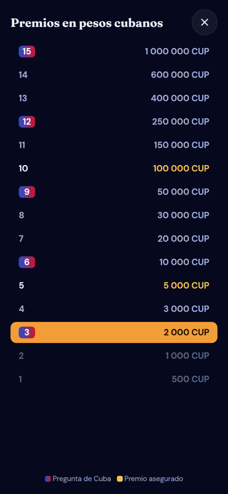

<div align="center">


# ¿Quién quiere ser millonario? · Edición Cuba

Juego de preguntas para Android inspirado en el clásico concurso de televisión, con un toque cubano:
cinco de las quince preguntas son sobre Cuba y el premio mayor es de **1 000 000 CUP**.

[](https://github.com/yopcubita/millonario-cuba/actions/workflows/apk.yml)




</div>

---

## Índice

- [Características](#características)
- [Descargar e instalar](#descargar-e-instalar)
- [Cómo se juega](#cómo-se-juega)
- [Escalera de premios](#escalera-de-premios)
- [Capturas](#capturas)
- [Tecnologías](#tecnologías)
- [Estructura del proyecto](#estructura-del-proyecto)
- [Compilar desde el código](#compilar-desde-el-código)
- [Añadir o editar preguntas](#añadir-o-editar-preguntas)
- [Créditos](#créditos)
- [Licencia](#licencia)

## Características

- **15 preguntas por partida**, de fácil a difícil.
- **Preguntas de Cuba** en las rondas 3, 6, 9, 12 y 15, con su propia presentación: bandera ondeando y música.
- **114 preguntas en total**: 60 de cultura general y 54 sobre Cuba (historia, geografía, música, deporte, comida y expresiones cubanas). Se eligen al azar en cada partida y las respuestas se barajan.
- **Premios en pesos cubanos (CUP)**, hasta 1 000 000 CUP.
- **Tres comodines**:
  - **50:50**: elimina dos respuestas incorrectas.
  - **Preguntar al público**: muestra un gráfico de votos.
  - **Llamar a un amigo**: te contesta alguien como Yunior, Tía Mayra o Abuela Cachita.
- **Plantarse** en cualquier momento y llevarse lo ganado.
- **Récord personal** guardado en el teléfono.
- **Sonido sintetizado**, con botón para silenciarlo.
- **Funciona sin internet**: las fuentes y todos los recursos van dentro de la app.

## Descargar e instalar

1. Ve a la sección [**Releases**](https://github.com/yopcubita/millonario-cuba/releases) y descarga `Millonario-Cuba.apk` desde el teléfono.
2. Abre el archivo. Si Android lo pide, permite **instalar apps de origen desconocido**.
3. Toca **Instalar** y listo.

> [!NOTE]
> El APK está firmado en modo de depuración (*debug*). Sirve para instalarlo y compartirlo, pero no para publicarlo en Google Play.

## Cómo se juega

1. Toca **Jugar** y responde tocando una de las cuatro opciones.
2. Si aciertas, subes al siguiente escalón de premios. Si fallas, te llevas el último premio asegurado.
3. Las preguntas **5** y **10** aseguran tu premio pase lo que pase.
4. Cada comodín solo se puede usar una vez por partida.
5. Si no estás seguro, puedes **plantarte** y llevarte lo que ya ganaste.

## Escalera de premios

| Pregunta | Premio | |
|:-:|--:|:--|
| 15 | **1 000 000 CUP** | 🇨🇺 Pregunta de Cuba |
| 14 | 600 000 CUP | |
| 13 | 400 000 CUP | |
| 12 | 250 000 CUP | 🇨🇺 Pregunta de Cuba |
| 11 | 150 000 CUP | |
| 10 | **100 000 CUP** | Premio asegurado |
| 9 | 50 000 CUP | 🇨🇺 Pregunta de Cuba |
| 8 | 30 000 CUP | |
| 7 | 20 000 CUP | |
| 6 | 10 000 CUP | 🇨🇺 Pregunta de Cuba |
| 5 | **5 000 CUP** | Premio asegurado |
| 4 | 3 000 CUP | |
| 3 | 2 000 CUP | 🇨🇺 Pregunta de Cuba |
| 2 | 1 000 CUP | |
| 1 | 500 CUP | |

## Capturas

<table>
  <tr>
    <td align="center"><br>Inicio</td>
    <td align="center"><br>Cultura general</td>
    <td align="center"><br>Llega una pregunta de Cuba</td>
  </tr>
  <tr>
    <td align="center"><br>Pregunta de Cuba</td>
    <td align="center"><br>Comodín del público</td>
    <td align="center"><br>Escalera de premios</td>
  </tr>
</table>

## Tecnologías

| Parte | Herramienta |
|---|---|
| Juego | HTML, CSS y JavaScript sin frameworks |
| App Android | [Capacitor 7](https://capacitorjs.com/) |
| Fuentes | [Fraunces](https://fonts.google.com/specimen/Fraunces) y [DM Sans](https://fonts.google.com/specimen/DM+Sans), licencia SIL OFL |
| Sonido | Web Audio API, sin archivos de audio |
| Compilación automática | GitHub Actions |

## Estructura del proyecto

```
millonario-cuba/
├── www/                     # El juego (lo que se ve en la app)
│   ├── index.html           # Pantallas: inicio, juego, final, premios
│   ├── style.css            # Estilos y animaciones
│   ├── game.js              # Lógica: premios, comodines, sonido, récord
│   ├── questions.js         # Banco de preguntas
│   └── fonts/               # Fuentes incluidas (funciona sin internet)
├── android/                 # Proyecto Android generado por Capacitor
├── docs/capturas/           # Imágenes para este README
├── .github/workflows/       # Compilación automática del APK
├── capacitor.config.json
└── package.json
```

## Compilar desde el código

### Opción 1: con GitHub Actions (sin instalar nada)

Cada cambio que subes a `main` compila el APK automáticamente. Lo encuentras en la pestaña **Actions**, dentro de la última ejecución, en **Artifacts**.

Para publicar una versión en **Releases**, crea una etiqueta:

```bash
git tag v1.1.0
git push origin v1.1.0
```

### Opción 2: en tu computadora

Requisitos: Node.js 20 o superior, JDK 21 y el Android SDK (por ejemplo, con Android Studio).

```bash
git clone https://github.com/yopcubita/millonario-cuba.git
cd millonario-cuba
npm install
npm run apk
```

El APK queda en `android/app/build/outputs/apk/debug/app-debug.apk`.

Para probar el juego en el navegador sin compilar nada, abre `www/index.html`.

## Añadir o editar preguntas

Todas las preguntas están en [`www/questions.js`](www/questions.js), separadas por categoría (`general` o `cuba`) y dificultad (`facil`, `medio` o `dificil`).

Cada pregunta es una lista donde **la primera opción es la correcta**. El juego baraja las opciones al mostrarlas:

```js
["¿Cuál es el ave nacional de Cuba?", "El tocororo", "El zunzún", "La cotorra", "El sinsonte"],
//  pregunta                          correcta       incorrectas…
```

Después de editar, sube los cambios y GitHub Actions compilará un APK nuevo.

## Créditos

Hecho por **yopcubita** · 2026
Con cariño desde Cuba 🇨🇺

Inspirado en el formato de *¿Quién quiere ser millonario?*. Este es un proyecto de fans sin fines comerciales y no tiene relación con los dueños del programa.

## Licencia

Código bajo licencia [MIT](LICENSE). Las fuentes incluidas usan la licencia SIL Open Font License.
